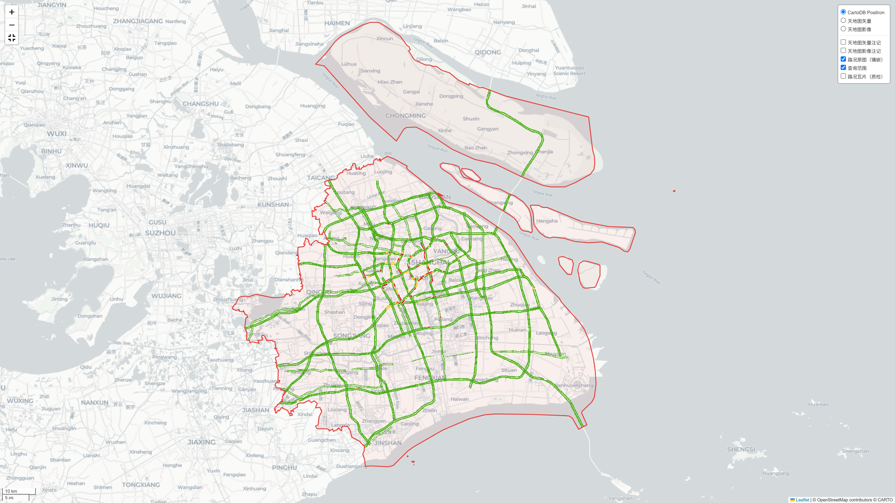
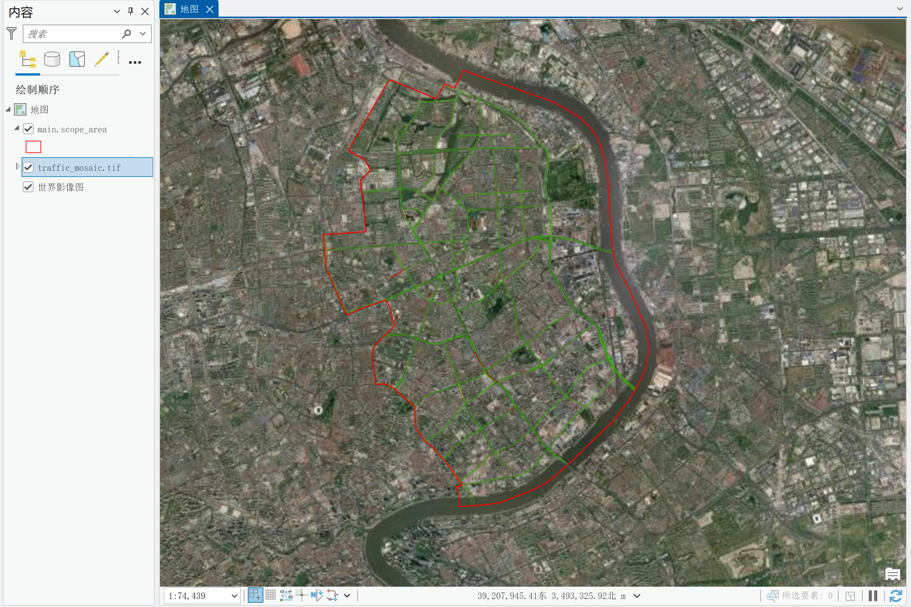

# Traffic Scope · 实时路况范围采集工具

> 输入一个空间范围（行政区划 / 矢量文件 / bbox），自动切分查询瓦片，批量采集**实时路况**（与百度 map.baidu.com 或高德 www.amap.com 网页端渲染同源），拼接为**地理参考镶嵌图**，产出可交互地图与可直接加载至 GIS 的路况栅格数据（WGS84）。
>
> **无需任何地图 AK、无配额限制。**





## 它能做什么

1. **三种范围输入**：
   - 输入 6 位行政区划代码（adcode），自动拉取 DataV.GeoAtlas 区县边界（GCJ-02→WGS84 修正）；
   - 导入本地矢量文件（shp / GeoJSON / KML / GeoPackage）；
   - 给定 bbox 矩形框 `[xmin, ymin, xmax, ymax]`，可用 `crs` 指定输入坐标系（`wgs84` / `gcj02` / `bd09`），工具自动转换；
2. **双数据源可选**：`traffic.provider` 设 `baidu`（百度，BD09MC 网格）或 `amap`（高德，标准 Web 墨卡托 XYZ），均取网页端路况图层实际请求的 PNG 瓦片，与网页端渲染同源；
3. **拼接镶嵌图**：全部瓦片拼接为一张**地理参考栅格**——GeoTIFF（EPSG:4326，带调色板）+ PNG 预览，QGIS/ArcGIS 直接加载；另附**原始瓦片拼接**（RGBA 四波段，保留路况原色、透明底；百度带白色描边，高德无描边更纯净）；
4. **GIS 数据输出**：查询范围面与路况瓦片网格以 GeoPackage / Shapefile / GeoJSON 输出，可直接加载至 GIS；
5. **可交互地图**：单文件 HTML，内嵌镶嵌路况原图，叠加状态图例与统计信息面板；
6. **工程化容错**：QPS 保守限速、指数退避重试、`--resume` 断点续跑、`render` 离线重出图（零请求）。

## 安装

推荐 conda（geopandas 依赖最稳）：

```bash
conda env create -f environment.yml
conda activate traffic-scope
```

或 pip（Python ≥ 3.10）：`pip install -r requirements.txt`

标准安装（仓库目录下）：

```bash
pip install .          # 注册 traffic-scope 命令
```

## 准备密钥

两个可选底图密钥，均填入 `configs/keys.txt`：

- **天地图 tk**（交互地图默认底图）：[天地图开放平台](https://console.tianditu.gov.cn/) 申请；
- **CartoDB key**（退回底图 Positron，免费）：[CARTO Basemaps](https://carto.com/basemaps/apikey/) 申请；无 key 时瓦片带 "API key required" 水印，填后即消失。

```bash
cp configs/keys.txt.example configs/keys.txt   # 填入 tianditu_tk / carto；切勿提交（已在 .gitignore 排除）
```

**采集路况本身不需要任何地图密钥。**

## 快速开始

```bash
cp configs/example.yaml configs/config.yaml   # 单一示例：内含 admin/bbox/file 三种范围写法，默认 bbox

# 第 1 步：干跑估算（不发起请求；-c 可省略，默认读 configs/config.yaml）
traffic-scope estimate

# 第 2 步：正式采集
traffic-scope run

# 用别的配置？显式指定
traffic-scope run -c configs/other.yaml

# 中断了？断点续跑（只补未成功瓦片）
traffic-scope run --resume runs/20260920_153000_admin_baidu

# 想换底图/调样式：离线重出图，零请求
traffic-scope render runs/20260920_153000_admin_baidu --basemap osm
```

## 数据源怎么选

| provider | 地图 | 瓦片网格 | level 范围 | 说明 |
|---|---|---|---|---|
| `baidu` | 百度 map.baidu.com | 官方 BD09MC（LL2MC 分带多项式） | 12–18 | 实测路网最密，`TrafficTileService` 端点 |
| `amap`（默认） | 高德 www.amap.com | 标准 Web 墨卡托 XYZ（GCJ-02） | 10–18 | `traffictile` 端点，原始瓦片无白描边、更纯净 |


**需要注意的是**——百度原始瓦片带白色道路描边，高德原始瓦片**没有白色描边、图面更为纯净**。若你主要用原始拼接图（原色）做展示或二次处理，**更推荐 `amap`**，无需额外去白。

## level（瓦片级别）怎么选

| level | 适用 |
|---|---|
| 低级别（12–13 百度 / 10–11 高德） | 大范围（全市/全区）概览 |
| 中级别（14–15） | 区县/片区，平衡密度与请求量 |
| 高级别（16–17） | 中小范围精细研究，含次干道/支路 |
| 18 | 仅提几何分辨率，瓦片数会很多 |

**level 越高路网越密**，默认 `level: auto` 按范围面积自适应（**≤25 km² → 17，25–200 km² → 16，>200 km² → 15**；高德 level 分辨率更高，同面积建议比百度低 1 级）。

## 运行产物

```
runs/20260920_153000_admin_baidu/
├── config.yaml                 # 配置快照
├── metadata.json               # 采样时刻/瓦片统计（可复现性核心）
├── progress.csv                # 瓦片级进度（断点续跑依据）
├── raw/                        # 原始瓦片 PNG 存档（离线重放用）
├── outputs/
│   ├── scope_area.*            # 查询范围面
│   ├── query_tiles.*           # 路况瓦片网格（质检漏抓）
│   ├── traffic_mosaic.tif      # 镶嵌路况 GeoTIFF（EPSG:4326 + 调色板）
│   ├── traffic_mosaic.png      # 镶嵌路况 PNG（透明底预览，四级语义色）
│   ├── traffic_mosaic_raw.tif  # 原始瓦片拼接 GeoTIFF（RGBA 四波段，保留原色）
│   ├── traffic_mosaic_raw.png  # 原始瓦片拼接 PNG（原色透明底；百度带白描边，高德无）
│   └── summary.json            # 统计摘要（含 provider 与像素状态分布）
└── map.html                    # 交互地图（镶嵌路况原图 + 图例 + 统计面板）
```

`traffic_mosaic.tif` 为单波段分类栅格（EPSG:4326，带调色板），GIS 里按像素值
分级设色（1畅通 2缓行 3拥堵 4严重拥堵）；`traffic_mosaic_raw.tif` 为 RGBA
四波段原始拼接，保留路况原色。

## 重要说明

- **数据来源**：百度 `traffic.map.baidu.com/traffic/TrafficTileService` 或高德`tm.amap.com/trafficengine/mapabc/traffictile`——两地图网页端路况图层**实际请求**的 PNG 瓦片，规格经浏览器抓包验证，与网页端所见严格同源。
- **未公开接口，仅限自用研究**：两接口均为地图厂商未公开文档接口，本工具仅限
  自用研究，**禁止批量抓取、再分发与商用**。接口行为可能随前端改版变化，工具内置格式校验，异常时会明确报错。
- **没有速度数值与道路名**：栅格只含四级拥堵着色，不含 km/h 速度与路名。
- **路况是分钟级快照**：同一范围不同时刻结果不同，引用成果请标注`metadata.json` 中的采样时刻。
- **数据合规**：路况数据权属相应地图厂商，公开研究成果时请注明数据来源与采样
  时刻；交互地图底图 © 相应提供方（天地图 / OpenStreetMap contributors © CARTO）。
  
## License

MIT（代码）。路况数据与地图底图的数据权属分别归相应地图厂商与提供方。
